<h1 align="center">IBKR Dashboard</h1>

<p align="center">
  
</p>

A desktop dashboard for one Interactive Brokers account. Track holdings, trades,
cash, and performance using live IBKR data and historical Flex reports.
**Read-only**: no orders are placed. Currently expects a USD base account.

## Install

Download an installer from a completed [Desktop bundles workflow run](https://github.com/samueljwu/ibkr-read-only/actions/workflows/bundles.yml).
Extract the downloaded artifact, then:

- **Windows x64:** run `IBKRDashboard-<version>-windows-x64-setup.exe`.
- **macOS (Apple silicon):** open `IBKRDashboard-<version>-macos-arm64.dmg` and drag the app to Applications.

Python is bundled. Windows builds are unsigned; macOS builds are unsigned and not notarized.

## Connect IBKR

The app starts in **Mock mode** so you can explore first.

1. In TWS or IB Gateway, enable the socket API and **Read-Only API**. Note the host and port.
2. In IBKR Client Portal, create three account-scoped XML Activity Flex queries: **Trades**, **Analytics**, and **Cash**. Enable Flex Web Service and generate a token.
3. In **Settings → Use IBKR**, enter the connection details, account ID, and query IDs. Click **Apply Settings**.
4. Paste the token and click **Save Flex token**, then **Sync IBKR**.

For query fields and setup details, open **Help → User guide (F1) → Start**.

## Explore

- **Overview:** account totals, holdings, prices, and P&L.
- **Trades & Lots:** executions, open lots, and sale-to-purchase matching.
- **Cash:** deposits, income, taxes, and fees.
- **Analytics:** NAV, returns, exposure, and buy/sell levels. Missing history can make results partial.
- **Rebalance:** plan target weights and price scenarios.

Try **Help → Take a tour** for a walkthrough.
Use **File → Import Data** for older Flex reports or paired PortfolioAnalyst
and Activity Statement CSVs. See the in-app guide for import limits.

## Your data

- Portfolios, backups, and logs stay local. Change folders in **Settings**.
- Packaged data: `%LOCALAPPDATA%\IBKRDashboard\prod\data` on Windows;
  `~/Library/Application Support/IBKRDashboard/prod/data` on macOS.
- Source runs use `dev/data` instead of `prod/data`.
- The renamed app does not automatically select the previous `CustomIBMonitor` folder.
  To continue an existing portfolio, launch with `--database PATH` pointing to its
  `portfolio.sqlite3`, then set the new data directory in **Settings**.
- Flex tokens and database keys stay in the OS credential store.
- New databases and backups are encrypted; older copies and exports may not be.
- Save your first-launch recovery code outside the data and backup folders.

## Run from source

Requires Python 3.11+.

```text
python -m pip install -r requirements.txt
python main.py
```

[Build installers](packaging/README.md) · [License: GNU GPLv3](LICENSE)

## Screenshots

<table>
  <tr>
    <td align="center" valign="top" width="50%"><strong>Overview</strong><br><a href="docs/images/demo-overview.png">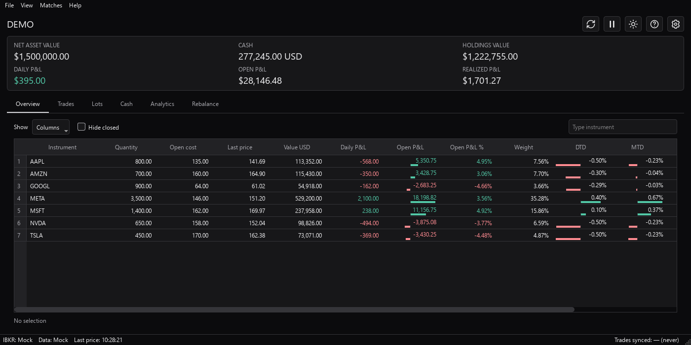</a></td>
    <td align="center" valign="top" width="50%"><strong>Trades</strong><br><a href="docs/images/demo-trades.png">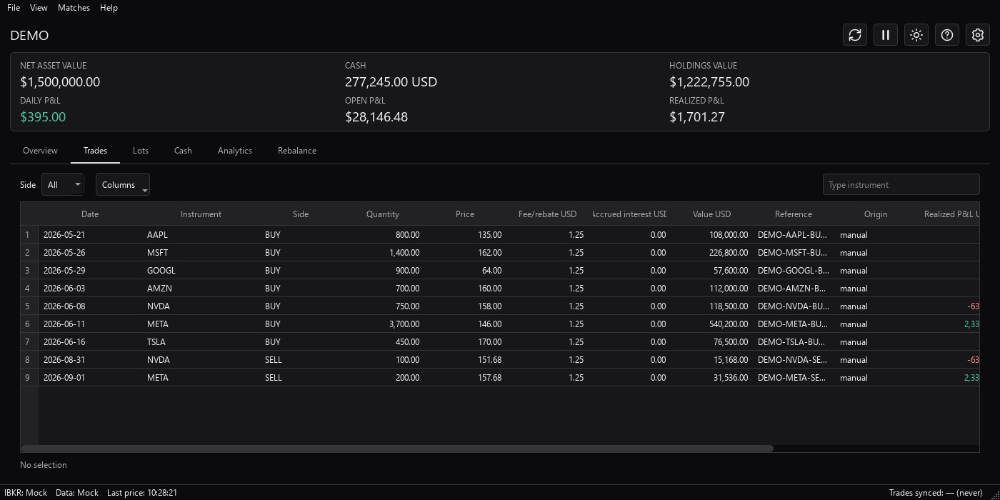</a></td>
  </tr>
  <tr>
    <td align="center" valign="top" width="50%"><strong>Lots</strong><br><a href="docs/images/demo-lots.png">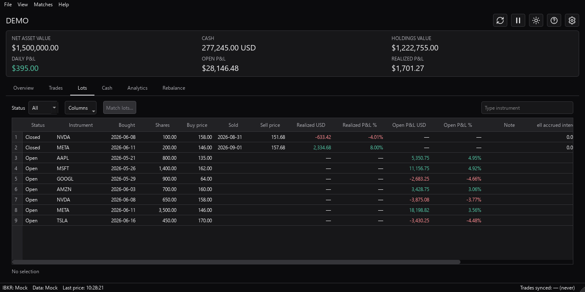</a></td>
    <td align="center" valign="top" width="50%"><strong>Cash</strong><br><a href="docs/images/demo-cash.png">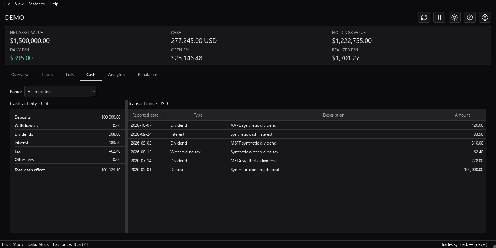</a></td>
  </tr>
  <tr>
    <td align="center" valign="top" width="50%"><strong>Analytics</strong><br><a href="docs/images/demo-analytics.png">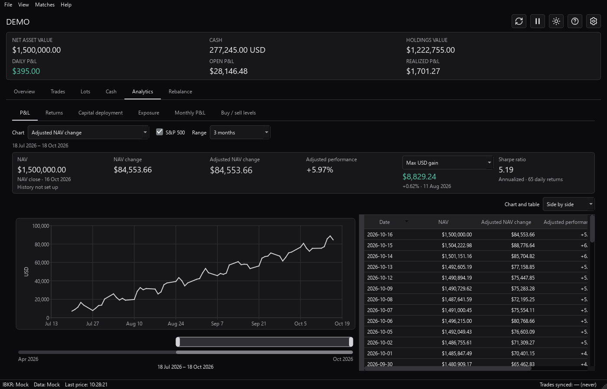</a></td>
    <td align="center" valign="top" width="50%"><strong>Rebalance</strong><br><a href="docs/images/demo-rebalance.png">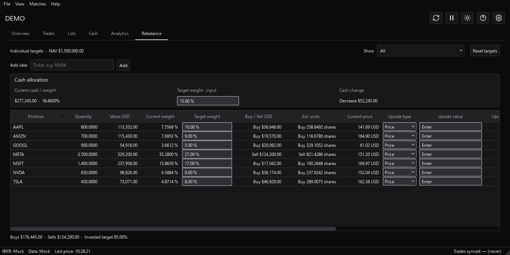</a></td>
  </tr>
</table>

### Analytics sections

<table>
  <tr>
    <td align="center" valign="top" width="50%"><strong>P&amp;L</strong><br><a href="docs/images/demo-analytics.png"></a></td>
    <td align="center" valign="top" width="50%"><strong>Returns</strong><br><a href="docs/images/demo-analytics-returns.png">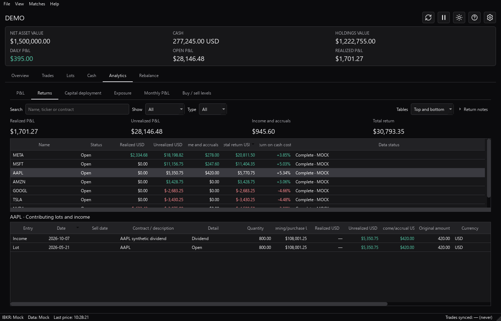</a></td>
  </tr>
  <tr>
    <td align="center" valign="top" width="50%"><strong>Capital deployment</strong><br><a href="docs/images/demo-analytics-capital.png">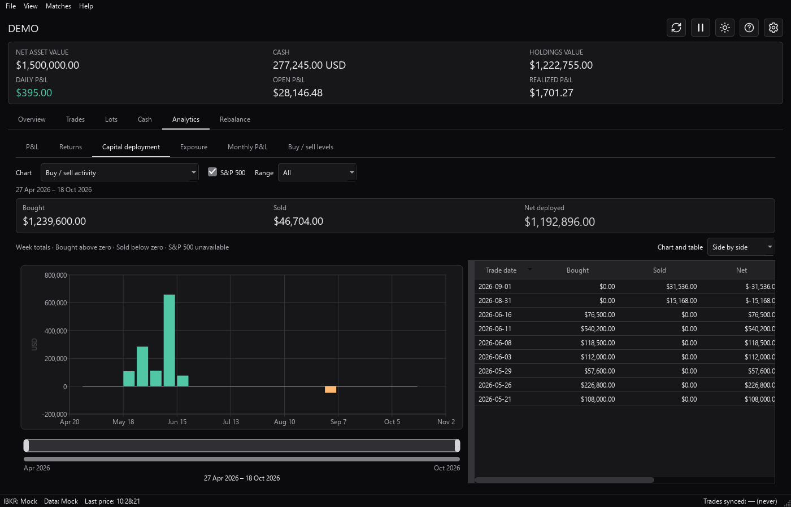</a></td>
    <td align="center" valign="top" width="50%"><strong>Exposure</strong><br><a href="docs/images/demo-analytics-exposure.png">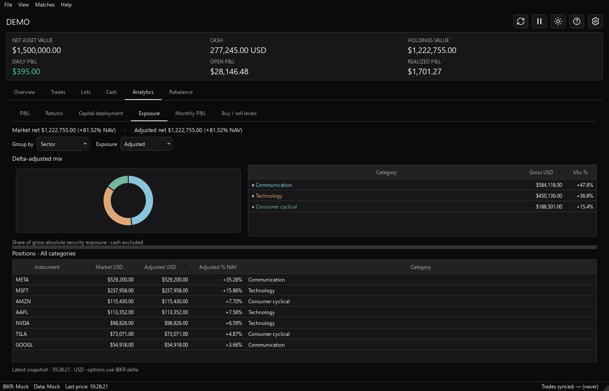</a></td>
  </tr>
  <tr>
    <td align="center" valign="top" width="50%"><strong>Monthly P&amp;L</strong><br><a href="docs/images/demo-analytics-monthly.png">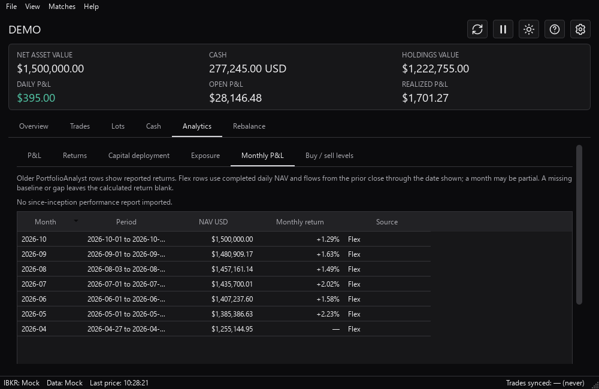</a></td>
    <td align="center" valign="top" width="50%"><strong>Buy / sell levels</strong><br><a href="docs/images/demo-analytics-levels.png">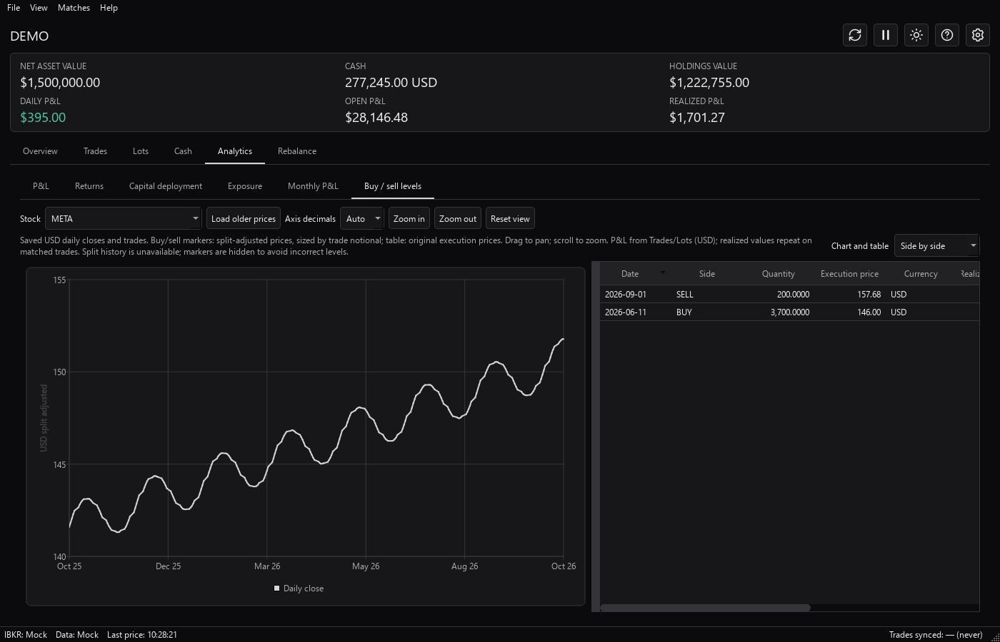</a></td>
  </tr>
</table>
